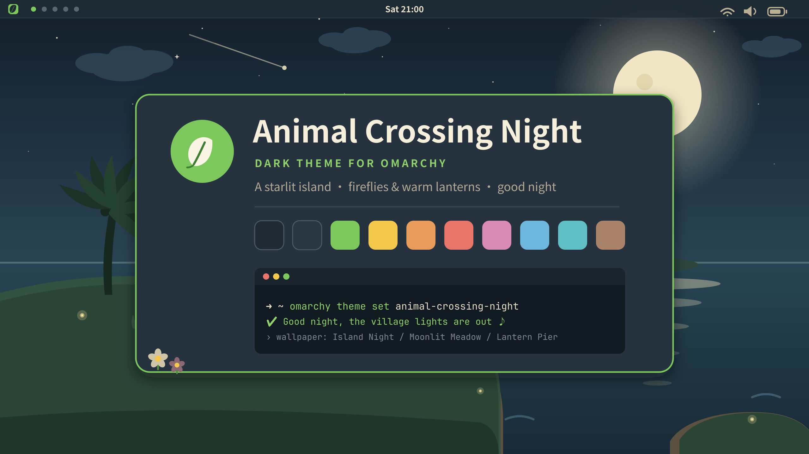
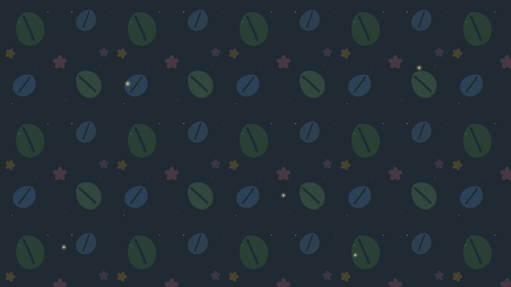

# 🌙 Animal Crossing Night for Omarchy

The night-time sister theme of [**Animal Crossing for Omarchy**](https://github.com/junbaor/omarchy-animal-crossing-theme): a moonlit island in deep navy, with fireflies and warm lanterns on the pier. Good night, village.

Language: **English** · [简体中文](README.zh-CN.md)



## Wallpapers

| Island Night | Moonlit Meadow | Lantern Pier |
|:---:|:---:|:---:|
|  |  |  |

Cycle them with `omarchy theme bg next`.

## Install

```bash
omarchy theme install https://github.com/junbaor/omarchy-animal-crossing-night-theme
omarchy theme set animal-crossing-night
```

## Palette

| Role | Hex | Note |
|---|---|---|
| Background | `#1F2A33` | Moonlit navy |
| Accent | `#7CC85C` | Firefly leaf green |
| Foreground | `#E6DEC8` | Moonbeam cream |
| Yellow | `#F2C94C` | Lantern gold (🔔) |
| Blue | `#6FB6DC` | Night sea |
| Red | `#E8756A` | Coral |
| Magenta | `#D98BB5` | Petal pink |
| Cyan | `#5FBFC4` | Firefly teal |
| Brown | `#A9846A` | Night timber |

Full palette in [colors.toml](colors.toml). Foreground colors are calibrated to WCAG contrast (≥ 4.5:1).

## Day & night

- ☀️ Day: [omarchy-animal-crossing-theme](https://github.com/junbaor/omarchy-animal-crossing-theme)

Use the cream island by day and the starlit island by night — `omarchy theme switcher` to flip.

## Customization

1. Edit `~/.config/omarchy/themes/animal-crossing-night/colors.toml`
2. Run `omarchy theme refresh`

Terminals, Neovim, btop, VS Code, GTK, fcitx5, menus/notifications/lock screen — everything is generated from `colors.toml` automatically.

## Boot splash

Wear the theme at boot too: menu → Style → Unlock, or

```bash
sudo omarchy-plymouth-set-by-theme animal-crossing-night
```

## Files

```
├── colors.toml        # core palette (everything else is generated from it)
├── backgrounds/       # three original 2560×1440 night wallpapers
├── sources/           # SVG sources of the wallpapers — remix welcome
├── preview.png        # theme picker preview
├── icons.theme        # icon pack (Yaru-olive-dark)
├── keyboard.rgb       # keyboard backlight color
├── unlock.png         # Plymouth boot logo (firefly green)
└── preview-unlock.png # boot splash preview
```

## Related

- [Omarchy](https://omarchy.org/)

All wallpapers are original vector art (SVG sources in `sources/`), free to modify and reuse.

## License

[MIT](LICENSE)
